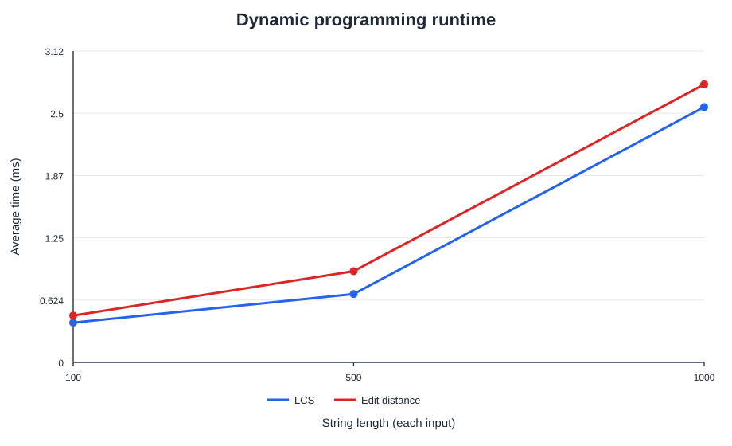
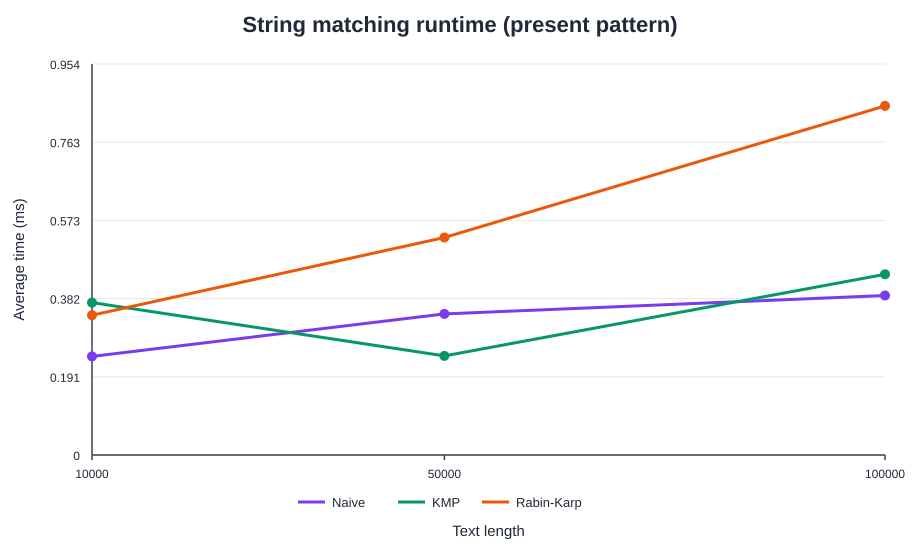
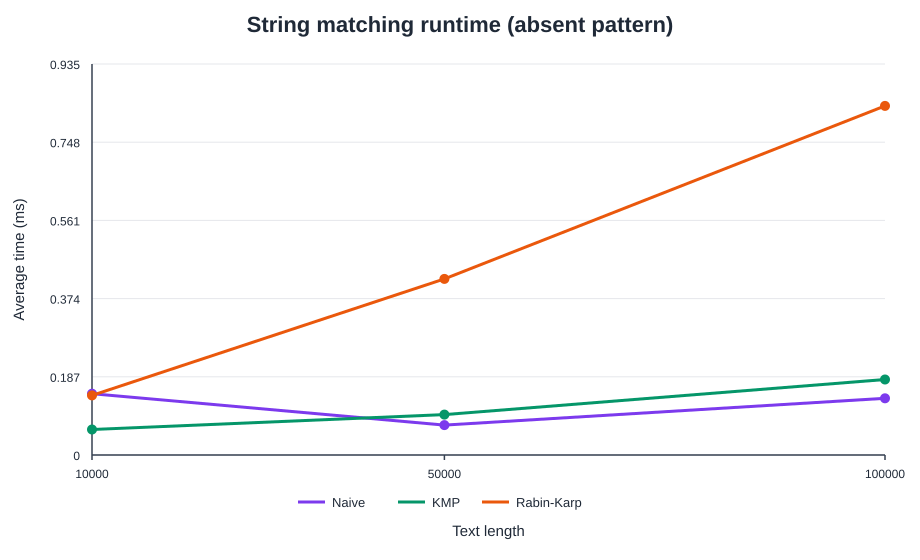
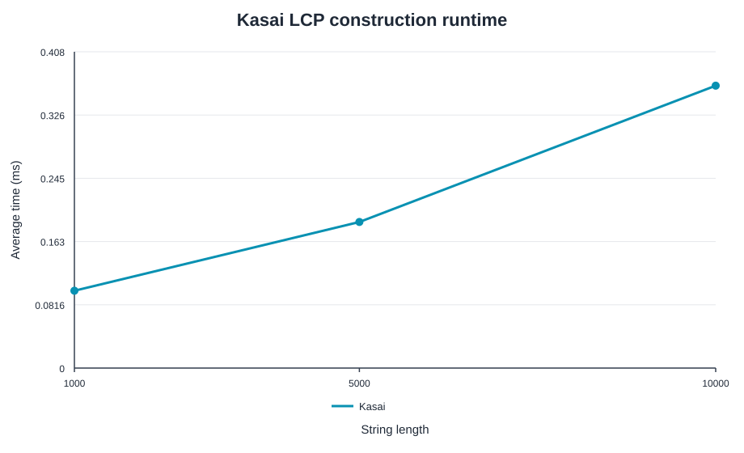

# Assignment 4: Text Analysis with Dynamic Programming and String Algorithms

## Summary

This Java project implements and compares the algorithms required by Assignment 4:

- Longest Common Subsequence (LCS)
- Levenshtein edit distance
- Naive, Knuth-Morris-Pratt (KMP), and Rabin-Karp string matching
- Kasai's Longest Common Prefix (LCP) array construction

The report, analysis, test strategy, measured results, and discussion are all in this README. The experiment CSV files and four plots are committed under `results/`.

## Build and run

Requirements: Java 17 or newer and Python 3. No third-party packages are needed.

From this directory, run:

```sh
bash run-tests.sh
bash run-experiments.sh
```

The test script compiles main and test sources and runs the dependency-free test suite. The experiment script compiles the application, writes CSV tables into `results/`, and regenerates the SVG plots from those tables. It takes roughly a few seconds on the machine used for this run.

## Project layout

```text
src/main/java/edu/assignment44/
  dp/DynamicProgramming.java       LCS and edit distance
  matching/StringMatchers.java     Naive, KMP, and Rabin-Karp
  suffix/KasaiLcp.java             Kasai LCP construction
  suffix/SuffixArrays.java         prefix-doubling suffix-array helper
  experiments/ExperimentRunner.java fixed workloads and timing
src/test/java/edu/assignment44/
  AlgorithmTests.java              correctness and edge-case checks
scripts/generate_plots.py          CSV-to-SVG plotting
results/                            measured CSV tables and plots
```

## Problem and algorithm overview

### Longest Common Subsequence

For prefixes ending at positions `i` and `j`, let `L[i][j]` be their LCS length. The base cases are `L[0][j] = L[i][0] = 0`. If the next characters match, `L[i][j] = L[i-1][j-1] + 1`; otherwise, `L[i][j] = max(L[i-1][j], L[i][j-1])`. The table explores all prefix pairs, and its final cell is the answer.

### Levenshtein edit distance

Let `D[i][j]` be the minimum edit count for the first `i` and `j` characters. The base cases are `D[i][0] = i` and `D[0][j] = j`. Each cell takes the minimum of deletion `D[i-1][j] + 1`, insertion `D[i][j-1] + 1`, and substitution/match `D[i-1][j-1] + cost`, where the cost is zero for equal characters and one otherwise. Each choice represents the last operation in an optimal edit sequence.

### String matching

All three matchers return **all zero-based starting indices**, including overlapping matches. An empty pattern is defined to match at every text boundary, yielding indices `0` through `text.length()`; a pattern longer than the text yields no matches.

- **Naive:** checks each possible alignment from left to right and stops an alignment at its first mismatch.
- **KMP:** builds the pattern's longest-prefix-suffix (LPS) table. After a mismatch it falls back to the longest still-viable prefix, so text characters already matched are not rescanned from the beginning.
- **Rabin-Karp:** computes a polynomial rolling hash modulo `1,000,000,007` with radix `256`. It updates the window hash in constant time. Equal hashes trigger a character-by-character verification, so collisions can add work but cannot create a false match. The tests include a deliberate collision using UTF-16 characters.

The implementation compares Java UTF-16 `char` code units. The operation counts in the experiment table are text-pattern character equality checks during search. They exclude KMP preprocessing and Rabin-Karp hash arithmetic.

### Kasai LCP array

For a string of length `n` and a suffix array `sa`, `lcp[r]` is the common-prefix length of suffixes starting at `sa[r-1]` and `sa[r]`; `lcp[0]` is zero. The inverse-rank array maps a suffix start to its sorted position. Kasai scans suffixes in text order and reuses the previous common-prefix length minus one, which bounds total character advances linearly. `KasaiLcp.build` expects the supplied suffix array to be a permutation of all suffix starts.

The assignment only requires Kasai's algorithm, given a suffix array. For the larger experiment inputs, this project supplies that input with a separate prefix-doubling helper. That helper is not included in Kasai's reported timing or required-algorithm complexity table.

## Complexity analysis

Let `n` and `m` be the two input lengths for dynamic programming; for matching, let `n` be text length and `m` be non-empty pattern length. `k` is the number of reported matches. Space below is auxiliary space and excludes the returned match-index list unless stated.

| Algorithm | Main recurrence or operation | Best-case time | Worst-case time | Auxiliary space | Why |
|---|---|---:|---:|---:|---|
| LCS | Fill each prefix-pair cell once | `O(nm)` | `O(nm)` | `O(nm)` | The full `(n+1) x (m+1)` table is evaluated. |
| Edit distance | Minimum of delete, insert, substitute/match for each cell | `O(nm)` | `O(nm)` | `O(nm)` | The full prefix-pair table is evaluated. |
| Naive matching | Compare pattern characters at each text alignment | `O(n-m+1)` | `O((n-m+1)m)` | `O(1)` | A mismatch at each first character gives best case; repeated near-matches cause worst-case rescanning. |
| KMP | LPS preprocessing, then a forward text scan with failure links | `O(n+m)` | `O(n+m)` | `O(m)` | Each text position advances or falls back through the LPS links a bounded number of times. |
| Rabin-Karp | Hash each window; verify windows whose hash equals the pattern hash | Expected `O(n+m)` | `O((n-m+1)m)` | `O(1)` | Rolling updates are constant time; many colliding windows can each require `m` verification comparisons. |
| Kasai LCP | Build inverse ranks, then reuse/decrease the previous LCP | `O(n)` | `O(n)` | `O(n)` | The carried match length decreases by at most one per suffix and increases only across characters scanned. |

The match-index output itself uses `O(k)` space. For the empty-pattern convention, each matcher necessarily takes `O(n)` time and output space because it returns `n+1` indices. Rabin-Karp's expected bound assumes few hash hits; its worst-case bound includes collision verification. The separate comparison-sort suffix-array helper uses `O(n log^2 n)` time and `O(n)` space, and its cost is outside Kasai measurements.

## Correctness and tests

The suite is dependency-free and checks 42 assertions:

- **LCS:** a known example, identical strings, disjoint strings, subsequences, and an empty input.
- **Edit distance:** identical strings, an empty input, and examples requiring substitution, insertion, and deletion.
- **String matching:** matches at the beginning, middle, and end; overlapping multiple matches; absent and too-long patterns; empty patterns; and a Rabin-Karp hash collision. For every case, the three matchers must return the same expected index list.
- **Kasai:** manually verified `banana` suffix array `[5, 3, 1, 0, 4, 2]` and LCP array `[0, 1, 3, 0, 0, 2]`, plus the empty input. The suffix-array helper is also checked on `banana` and a one-character string.

Latest run:

```text
All 42 checks passed.
```

## Experimental setup

- Input sizes follow the assignment: LCS and edit distance use equal-length pairs of `100`, `500`, and `1,000`; string matching uses text lengths `10,000`, `50,000`, and `100,000`; Kasai uses strings of `1,000`, `5,000`, and `10,000` characters.
- Random strings use alphabet `{a,b,c,d}` and fixed seed `20261108`. Each size's inputs are prepared once and reused for all five timed measurements of that algorithm.
- Matching uses pattern length `16`. The present pattern is a slice of its text. The absent pattern is sixteen `z` characters, which cannot occur in the generated text. All three matchers receive exactly the same text and pattern for each size and scenario; the runner checks their returned lists agree before timing.
- Each result is warmed up five times, then measured five times with `System.nanoTime()`. The reported value is the arithmetic mean. Input generation, operation counting, correctness comparisons, console output, and file output are outside measured regions. Timed results are retained through a volatile sink to prevent the JVM from eliminating unused work.
- String-matching character-comparison counts are collected in a separate, untimed pass. Kasai's comparison count is also collected outside timing. Dynamic-programming algorithms report elapsed time only.
- The runtime used for the recorded data was Eclipse Temurin OpenJDK `25.0.1`. Host load, CPU scheduling, and JVM behavior are not controlled, so small timing differences should not be treated as universal performance rankings.

## Experimental results

### Dynamic programming

Average time in milliseconds for each pair of strings:

| Length of each string | LCS (ms) | Edit distance (ms) |
|---:|---:|---:|
| 100 | 0.398 | 0.470 |
| 500 | 0.685 | 0.914 |
| 1,000 | 2.560 | 2.788 |



### String matching

Average time is in milliseconds. Comparison counts are shown as `Naive / KMP / Rabin-Karp`.

| Scenario | Text length | Matches | Naive (ms) | KMP (ms) | Rabin-Karp (ms) | Character comparisons |
|---|---:|---:|---:|---:|---:|---:|
| Present | 10,000 | 1 | 0.241 | 0.372 | 0.341 | 13,235 / 12,392 / 16 |
| Absent | 10,000 | 0 | 0.147 | 0.061 | 0.143 | 9,985 / 10,000 / 0 |
| Present | 50,000 | 1 | 0.344 | 0.242 | 0.531 | 66,927 / 62,556 / 16 |
| Absent | 50,000 | 0 | 0.072 | 0.097 | 0.421 | 49,985 / 50,000 / 0 |
| Present | 100,000 | 1 | 0.389 | 0.441 | 0.852 | 133,211 / 124,922 / 16 |
| Absent | 100,000 | 0 | 0.136 | 0.180 | 0.835 | 99,985 / 100,000 / 0 |





### Kasai LCP construction

Suffix-array construction is completed before timing; only Kasai's LCP construction is measured.

| String length | Average time (ms) | Character comparisons |
|---:|---:|---:|
| 1,000 | 0.100 | 1,990 |
| 5,000 | 0.188 | 9,988 |
| 10,000 | 0.364 | 19,989 |



The full raw tables are [dynamic-programming.csv](results/dynamic-programming.csv), [string-matching.csv](results/string-matching.csv), and [kasai.csv](results/kasai.csv).

## Discussion

The dynamic-programming timings increase overall as the square tables grow, consistent with `O(nm)` work, although the smallest sizes are dominated more by allocation and JVM/runtime effects than by asymptotic growth. LCS and edit distance have similar table sizes; the edit-distance cell performs a three-way minimum, while the LCS cell does a match check and a maximum.

The comparison counts illustrate KMP's reuse of matched prefixes: it performs about one text comparison per character on the absent workloads, while naive search repeats the pattern's first-character check at each alignment. On these seeded random texts, naive search's average successful-prefix length is short, so it remains competitive. Rabin-Karp uses very few direct character checks because its hashes rarely match, but rolling-hash arithmetic costs more than a simple mismatch check in these modest workloads. This is an example of why comparison counts and wall-clock time measure different things. The implementation's collision verification preserves correctness even if hash collisions occur.

Kasai's character-comparison counts grow almost linearly with input length for the generated data, as expected from the reused-prefix argument. Measurements for this helper exclude suffix-array construction, which is a separate preprocessing step.

All measurements are one-machine averages over five timed samples. They support the theoretical trends but do not establish a universal speed winner; JVM warm-up, garbage collection, the text alphabet, pattern length, match density, CPU scheduling, and hash behavior can change observed times.

## Conclusion

The project implements the required dynamic-programming, exact-matching, and LCP algorithms and records reproducible workloads with fixed seeds. The main trade-offs are clear: the DP methods provide direct quadratic-table solutions; naive matching is simple and can perform well when mismatches occur early; KMP offers a linear worst-case scan by remembering prefixes; Rabin-Karp uses fast rolling hashes but must verify hash hits and has a quadratic worst case; Kasai builds all adjacent-suffix common-prefix lengths in linear time once the suffix array is available.
